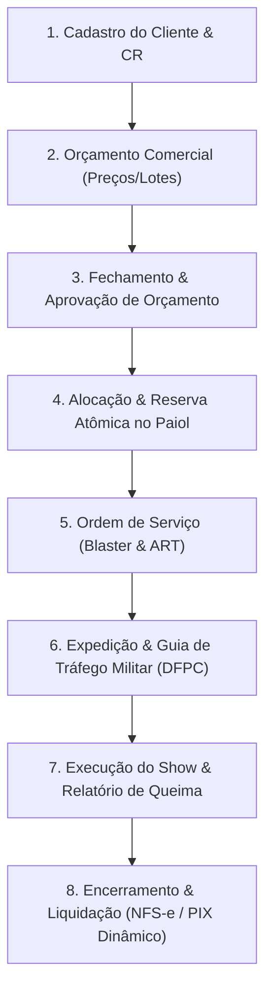

# Jornada Operacional de Ponta a Ponta (Golden Path) — SisPiro ERP

Este documento estabelece o **fluxo operacional de referência** do SisPiro ERP, detalhando o ciclo de vida completo de uma operação pirotécnica desde a prospecção inicial do cliente até a liquidação financeira e fiscal.

---

## 🗺️ Visão Geral do Ciclo de Vida do Espetáculo Pirotécnico

---

## 📋 Detalhamento dos 8 Passos da Jornada

### 1. Cadastro do Cliente & Conformidade Regulatória (DFPC / R-105)
- **Objetivo**: Garantir que apenas clientes idôneos e regulamentados adquiram produtos pirotécnicos ou contratem espetáculos.
- **Regras de Negócio**:
  - Distinção entre Pessoa Física (CPF) e Pessoa Jurídica (CNPJ).
  - Para clientes corporativos de material controlado: conferência obrigatória de Certificado de Registro (**CR**) do Exército, data de validade da certidão e classes autorizadas (`CLASSE_A`, `CLASSE_B`, `CLASSE_C`, `CLASSE_D`).
  - Trava atômica no backend: clientes inativos ou com CR vencido são sumariamente bloqueados para abertura de orçamentos e Ordens de Serviço.
- **Módulo**: `/modules/customers`

---

### 2. Orçamento Comercial & Reserva Preventiva
- **Objetivo**: Compor o custo do espetáculo ou venda técnica com aplicação automática de políticas comerciais.
- **Regras de Negócio**:
  - Motor de precedência de preços: comparação dinâmica entre o preço da tabela ativa (`PriceList`) e eventuais campanhas promocionais vigentes (`ProductPromotion`), aplicando sempre o menor valor efetivo.
  - Seleção estrita de lotes em situação `DISPONIVEL` (materiais em `QUARENTENA` ou `BLOQUEADO` não podem ser selecionados).
  - Reserva temporária de estoque para garantir a disponibilidade física até o vencimento da proposta.
- **Módulo**: `/modules/sales` e `/modules/operations`

---

### 3. Fechamento & Aprovação de Orçamento
- **Objetivo**: Formalizar o contrato e converter a intenção comercial em execução operacional.
- **Regras de Negócio**:
  - Lock pessimista do registro contra condições de corrida (*race conditions*).
  - Verificação de elegibilidade do cliente para as classes de risco dos produtos cotados (`customers.checkPceEligibility`).
  - Confirmação da data limite do evento e consolidação do valor total contratado.
- **Módulos**: `/modules/sales` (Venda de balcão/atacado) e `/modules/operations` (Ordem de Serviço).

---

### 4. Alocação & Retirada de Estoque (Paióis e Quarentena)
- **Objetivo**: Assegurar a integridade do estoque militar e a capacidade dos depósitos.
- **Regras de Negócio**:
  - Bloqueio definitivo da quantidade planejada nos lotes dos paióis de origem.
  - Verificação da capacidade volumétrica e da Massa Líquida de Explosivo Total (**NEQ em kg**) dos paióis.
  - Registro de auditoria transacional com identificação do operador responsável pela reserva.
- **Módulo**: `/modules/inventory`

---

### 5. Ordem de Serviço (Montagem Técnica & Blaster)
- **Objetivo**: Atribuir a responsabilidade técnica e o planejamento operacional do show.
- **Regras de Negócio**:
  - Designação do **Blaster profissional responsável** devidamente habilitado.
  - Validação algorítmica: o sistema rejeita Blasters com carteira profissional vencida perante a data de realização do evento (`eventAt`).
  - Registro obrigatório do número da **ART** (Anotação de Responsabilidade Técnica) emitida perante o Conselho Regional (CREA/CRQ).
  - Transição de status da OS: `ORCAMENTO` ➔ `APROVADO` ➔ `EM_MONTAGEM`.
- **Módulo**: `/modules/operations`

---

### 6. Expedição & Guia de Tráfego Militar (GT DFPC / SFPC)
- **Objetivo**: Legalizar o transporte rodoviário de Produtos Controlados pelo Exército (PCE) até o local do evento.
- **Regras de Negócio**:
  - Numeração anual sequencial auditada pelo Exército Brasileiro (`GT-YYYY/NNNN`).
  - Cálculo automático em tempo real da carga explosiva total (soma da NEQ dos itens em kg).
  - Identificação completa do transporte: veículo, placa/UF, itinerário rodoviário e condutor com habilitação **MOPP** (Movimentação Operacional de Produtos Perigosos).
  - Geração e impressão do **Espelho Oficial Militar DFPC/COLOG**, contendo as classes de risco ONU (1.1G, 1.3G, 1.4G) e termos de responsabilidade técnica.
- **Módulo**: `/modules/compliance` (com atalho direto integrado na OS em montagem).

---

### 7. Execução do Evento Pirotécnico & Relatório de Queima
- **Objetivo**: Registrar a queima efetiva e o tratamento de sobras pós-evento.
- **Regras de Negócio**:
  - O operador informa a quantidade disparada (`firedQuantity`) por lote no encerramento.
  - **Baixa real de estoque**: O sistema gera movimentação `SAIDA` de consumo apenas para os itens efetivamente detonados.
  - **Devolução automática de sobras**: Quantidades não disparadas têm suas reservas canceladas e retornam automaticamente ao saldo disponível do paiol.
- **Módulo**: `/modules/operations` (Modal "Concluir Ordem").

---

### 8. Encerramento & Liquidação Financeira/Fiscal
- **Objetivo**: Registrar o faturamento fiscal e a quitação financeira instantânea.
- **Regras de Negócio**:
  - **Contas a Receber**: Ao fechar a OS, o sistema gera automaticamente o título financeiro (`FinancialEntry`) vinculado ao contrato.
  - **Emissão Fiscal**:
    - **NFS-e**: Emissão de Nota Fiscal de Serviços para espetáculos pirotécnicos com identificação do Blaster e ART.
    - **NF-e (Modelo 55)**: Emissão com NCM pirotécnico (3604.10.00), CFOP e chave SEFAZ de 44 dígitos com Dígito Verificador Módulo 11.
  - **Cobrança PIX Dinâmico**:
    - Geração de QR Code dinâmico na tela via padrão BACEN / BR Code EMVCo com valor e expiração.
    - Webhook bancário atômico para baixa e liquidação imediata para status `PAGO`.
  - **Conciliação OFX**: Leitura de extrato bancário para quitação em lote de títulos faturados.
- **Módulos**: `/modules/billing` e `/modules/finance`.

---

## ⚡ Elos de Transição Fluida no Frontend (UX 10/10)

Para que a experiência do usuário seja contínua, sem fricções e à prova de falhas regulatórias, os seguintes elos e componentes visuais conectam as etapas da jornada:

1. **Pipeline Visual Interativo na OS (`/modules/operations`)**:
   - **`OrderStepper` (Linha do Tempo de 5 Estágios)**: Exibe instantaneamente no detalhe da ordem o progresso do show pirotécnico:
     `1. Orçamento` ➔ `2. Aprovação & ART` ➔ `3. Guia de Tráfego` ➔ `4. Montagem & Queima` ➔ `5. Faturamento & PIX`.
   - Botão **`🚚 Emitir Guia de Tráfego (GT)`**: Presente nas ordens aprovadas ou em montagem, pré-carregando cliente, Blaster, itinerário e lotes.
   - Botão **`📄 Faturar / Emitir NFS-e`**: Nas ordens concluídas, integrando a nota de serviço com os dados da queima.
   - Botão **`📱 Receber via PIX`**: Abre o **PixModal** imediatamente com o QR Code dinâmico do valor contratado.

2. **Fechamento Fiscal & PIX Imediato no Balcão Comercial (`/modules/sales`)**:
   - Na listagem de vendas concluídas:
     - Botão **`📄 NF-e / NFC-e`**: Emissão direta de Nota Fiscal Eletrônica (Modelo 55 com destinatário) ou Cupom de Consumidor (Modelo 65 para balcão).
     - Botão **`📱 PIX`**: Abre o **PixModal** com QR Code dinâmico do valor da venda para o cliente escanear no balcão.

3. **Conversão Dual de Orçamento Comercial (`/modules/sales`)**:
   - Modal de conversão inteligente com escolha entre:
     - *"🛍️ Venda Direta / Balcão"* (baixa imediata de estoque e financeiro).
     - *"🎆 Ordem de Serviço (Espetáculo Pirotécnico & Blaster)"* (gera a OS em `/modules/operations` transferindo produtos, lotes, data e local do show).

4. **Monitoramento Preventivo de CR Militar (`/modules/customers`)**:
   - Cálculo automático de dias restantes para o vencimento do Certificado de Registro do Exército:
     - Menos de 30 dias: Badge pulsante âmbar *"⚠️ Vence em X dia(s)"*.
     - Vencido: Badge vermelha *"🚫 Vencido em DD/MM/AAAA (Bloqueado para PCE)"*.
     - Regular: Badge verde *"✓ Válido até DD/MM/AAAA"*.
   - Botão de ação rápida **`+ Orçamento`** direto na linha do cliente para iniciar vendas com 1 clique.

5. **Termômetro Visual de Carga Explosiva NEQ nos Paióis (`/modules/inventory`)**:
   - Barra de progresso com porcentagem de ocupação e código de cores militar:
     - `< 70%`: Verde (Capacidade regular)
     - `70% - 90%`: Âmbar (Alerta de ocupação elevada)
     - `> 90%`: Vermelho (Perigo de infração ao limite regulatório do R-105).

6. **Ações Rápidas de Despacho Rodoviário de GT (`/modules/compliance`)**:
   - Botão **`🚚 Iniciar Viagem`** (avanço com 1 clique de `EMITIDA` para `EM_TRANSITO`).
   - Botão **`🏁 Concluir Entrega`** (avanço com 1 clique de `EM_TRANSITO` para `CONCLUIDA`).
   - Botão **`Espelho GT`** com layout de impressão oficial em folha A4 para fiscalização rodoviária (PRF/Exército).
