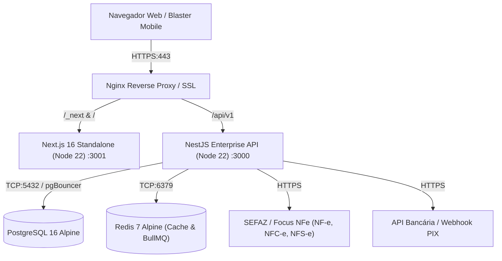

# Runbook de Implantação e Operação em Produção — SisPiro ERP

Este documento estabelece o guia oficial de Site Reliability Engineering (SRE), implantação de contêineres e procedimentos operacionais para colocar o **SisPiro ERP** em produção com alta disponibilidade, integridade de dados e conformidade com o Exército Brasileiro (R-105) e SEFAZ.

---

## 1. Topologia e Arquitetura de Produção

O sistema é implantado em uma arquitetura de microsserviços desacoplada com orquestração Docker:



### Componentes de Infraestrutura:
- **Frontend:** Next.js 16 Standalone com React 19, zero overhead de SSR desnecessário e assets estáticos com cache imutável de 1 ano.
- **Backend:** NestJS com modularização DDD, rate limiting atômico via Redis Lua scripts, pool de conexões PostgreSQL otimizado e traps de sinal POSIX (`SIGTERM`/`SIGINT`) para encerramento gracioso.
- **Banco de Dados:** PostgreSQL 16 com engine transacional estrita (ACID), isolation level pessimista para reservas de fogos e controle de concorrência.
- **Cache & Filas:** Redis 7 com persistência AOF (`appendonly: yes`) para rate limiting de login, tarefas assíncronas de e-mail e emissão fiscal.

---

## 2. Requisitos Mínimos do Servidor (Host)

| Recurso | Mínimo Recomendado | Produção Escala (>50 usuários simultâneos) |
| :--- | :--- | :--- |
| **SO** | Ubuntu Server 22.04 LTS / Debian 12 / RHEL 9 | Ubuntu Server 24.04 LTS |
| **CPU** | 2 vCPUs | 4 vCPUs |
| **Memória RAM** | 4 GB | 8 GB |
| **Armazenamento** | 40 GB SSD (NVMe recomendado) | 120 GB SSD NVMe |
| **Docker** | Engine v24.0+ e Docker Compose v2.20+ | Engine v27.0+ |

---

## 3. Passo a Passo de Implantação Inicial

### Passo 1: Clonar o Repositório no Servidor
```bash
git clone https://github.com/empresa/AppCasadeFogos.git /opt/sispiro
cd /opt/sispiro
```

### Passo 2: Configurar o Arquivo de Variáveis de Produção
Copie o modelo de ambiente de produção:
```bash
cp .env.production.example .env.production
chmod 600 .env.production
```
Edite o arquivo `.env.production` preenchendo as chaves com geradores criptográficos:
```bash
# Gere os segredos usando OpenSSL:
openssl rand -hex 32  # Para AUTH_JWT_SECRET
openssl rand -hex 32  # Para AUTH_REFRESH_SECRET
openssl rand -base64 24 # Para POSTGRES_PASSWORD
```

> [!IMPORTANT]
> Na **primeira inicialização**, certifique-se de definir `RUN_SEED=true` em `.env.production` para que o usuário administrador inicial (`demo.admin@local.test`) e a estrutura inicial de paióis sejam provisionados. Após o primeiro boot com sucesso, altere novamente para `RUN_SEED=false`.

### Passo 3: Executar o Pipeline Automatizado de Deploy
Execute o script oficial de implantação:
```bash
./scripts/deploy.sh
```
O script realizará automaticamente:
1. Verificação de dependências (`docker`, `docker compose`).
2. Backup preventivo se uma base de dados já existir.
3. Build multi-stage enxuto das imagens de backend e frontend.
4. Aplicação atômica de migrações (`prisma migrate deploy`).
5. Validação de prontidão do healthcheck HTTP (`/api/v1/health/live`).

---

## 4. Orquestração e Comandos Úteis

### Subir com o Gateway Nginx Unificado (Porta 80/443):
```bash
docker compose -f docker-compose.prod.yml --env-file .env.production --profile gateway up -d
```

### Visualizar Logs em Tempo Real:
```bash
# Todos os serviços:
docker compose -f docker-compose.prod.yml logs -f

# Apenas o backend:
docker logs -f --tail 100 sispiro_backend_prod

# Apenas o banco de dados:
docker logs -f --tail 50 sispiro_postgres_prod
```

### Parar e Reiniciar Serviços:
```bash
# Reiniciar backend suavemente:
docker compose -f docker-compose.prod.yml restart backend

# Desligar todos os contêineres preservando volumes de dados:
docker compose -f docker-compose.prod.yml down
```

---

## 5. Política de Backup & Disaster Recovery

A perda de dados em um ERP pirotécnico pode causar autuações severas pelo Exército (SFPC) e Receita Federal. O SisPiro inclui rotinas de auditoria e backup consistentes com hashes SHA256.

### Executar Backup Manual:
```bash
./scripts/backup.sh
```
Os backups são gravados em `./backups/postgres/` compactados via `gzip` e retidos por 30 dias com rotação automática.

### Agendamento de Backup Automático (Cron):
Adicione no crontab do servidor (`crontab -e`):
```bash
# Backup diário consistente às 02:00 da madrugada
0 2 * * * cd /opt/sispiro && ./scripts/backup.sh >> /var/log/sispiro_backup.log 2>&1
```

### Procedimento de Restauração em Caso de Desastre:
Para restaurar uma base a partir de um snapshot compactado:
```bash
./scripts/restore.sh ./backups/postgres/sispiro_backup_YYYYMMDD_HHMMSS.sql.gz
```
*O script exige confirmação explícita digitando `CONFIRMAR-RESTAURACAO` para evitar acidentes.*

---

## 6. Monitoramento de Saúde (Healthcheck)

Para diagnosticar a saúde da infraestrutura, CPU, memória, conexão com PostgreSQL e Redis:
```bash
./scripts/healthcheck.sh
```

Saída esperada em ambiente operacional saudável:
- `Liveness (/api/v1/health/live)`: `200`
- `Readiness (/api/v1/health/ready)`: `{"status":"ok","info":{"postgres":{"status":"up"},"redis":{"status":"up"}}}`
- `Frontend (HTTP 3001)`: `200`
